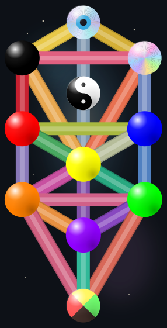

# Kaabalah

A comprehensive TypeScript library for numerology, astrology, kaabalah, gematria, tarot, I Ching, and Ifa divination.

<p align="center">
  
</p>

## Documentation

Full API reference, guides, and examples: **[docs.kaabalah.com](https://docs.kaabalah.com/)**

## Installation

```bash
npm install kaabalah
```

Node.js 18.18+ required.

## Modules

All modules are tree-shakable and can be imported independently:

| Module | Import | Description |
|--------|--------|-------------|
| Core | `kaabalah/core` | Tree of Life graph with cross-system correspondences |
| Numerology | `kaabalah/numerology` | Life path, cycles, challenges, personal year, dated schedules (as-of snapshots and timelines from civil dates), partial birth dates, pinnacles |
| Astrology | `kaabalah/astrology` | Birth charts, sect and lots, synastry, composite and Davison, exact transit and return events, progressions, profections, firdaria, orb policies, input quality, bulk collections, Jyotish (Dhruva and Lahiri nakshatras, dashas), astrocartography, dignity, decans, dodecatemoria |
| Gematria | `kaabalah/gematria` | Hebrew letter numerology |
| Tarot | `kaabalah/tarot` | 78-card deck with profiles, archetypes, correspondences, multi-deck images, spread engine |
| I Ching | `kaabalah/iching` | 64 hexagrams, classical Chinese and original English, Han technical derivations, tree-backed Kaabalah, coin casting |
| Ifa | `kaabalah/ifa` | Odu divination |
| Semantic | `kaabalah/semantic` | Theme profiles, kaabalistic overlay correspondences, symbol metadata |
| Visual | `kaabalah/visual` | Tree of Life and astrology wheel SVG generation plus layout/render-model data |

Civil-date helpers (`parseCivilDate`, `completedYears`, ...) and JSON/Markdown tabulation helpers (`toTable`, `toMarkdownTable`) are exported from the package root `kaabalah`.

The Swiss Ephemeris runtime assets are also exported for bundlers and servers: `kaabalah/swisseph-runtime` (JS) and `kaabalah/swisseph-wasm` (WebAssembly). See the [WebAssembly guide](https://docs.kaabalah.com/guides/webassembly/).

## Quick Example

```typescript
import { createTree, id, KaabalahTypes } from 'kaabalah/core';
import { getBirthChart } from 'kaabalah/astrology';
import { calculateKaabalisticLifePath, getNumerologySnapshot } from 'kaabalah/numerology';
import { getTarotCorrespondenceProfile } from 'kaabalah/tarot';
import { generateAstroWheelSvg, generateTreeSvg } from 'kaabalah/visual';

const tree = createTree({ system: 'kaabalah', parts: ['westernAstrology', 'tarot'] });
const correspondences = tree.getCorrespondences(id(KaabalahTypes.SPHERE, 'Tiphareth'), { depth: 2 });

const chart = await getBirthChart({
  date: { year: 1990, month: 6, day: 15, hour: 14, minute: 30 },
  latitude: 48.856, longitude: 2.352,
});

const lifePath = calculateKaabalisticLifePath(new Date(1990, 5, 15, 12)); // legacy Date API: local noon
const asOf = getNumerologySnapshot({ birth: '1990-06-15', asOf: '2026-01-01' }); // civil dates: no timezone workaround
const magician = getTarotCorrespondenceProfile({ tarotCardName: 'The Magician' });
const svg = generateTreeSvg({ background: 'transparent', palette: 'monochrome' });
const wheelSvg = generateAstroWheelSvg(chart, { background: 'transparent' });
```

## I Ching

```ts
import { getIChingReading, castThreeCoins } from 'kaabalah/iching';

const reading = getIChingReading('879777'); // six classical lines, bottom to top
const replay = getIChingReading(30, [2, 4]); // same as lines 767987
const cast = castThreeCoins(); // inject an RNG for reproducible tests
```

Store the six cast lines; derive the cast, moving lines, transformed and nuclear figures, palace, 納甲, 六親, 世/應 relations, line transforms, Zhu Xi texts, sovereign months, and separate Kaabalah gate/family/pillar layers. Static casts have a null transformed state. With six moving lines, 乾 uses 用九 and 坤 uses 用六. Transform `after` relatives use the destination palace; `afterInCastPalace` provides the original palace frame. See the [I Ching API and source notes](src/iching/README.md).

## Language

English is the default. Pass `'pt-BR'` to localized text getters:

```ts
import { getTarotCardProfile } from 'kaabalah/tarot';
import { getIChingReadingContent } from 'kaabalah/iching';

getTarotCardProfile({ tarotCardNumber: 20 }, 'pt-BR')?.tarotMeaning;
getIChingReadingContent('879777', 'pt-BR').oracle[0].text.content;
```

See [Portuguese text APIs](https://docs.kaabalah.com/guides/localization/) for card/deck descriptions, spreads, numerology, gematria, tree descriptions, astrology labels and CLI language selection.

## CLI

```bash
npx kaabalah help                    # list all commands
npx kaabalah help --json             # full schema introspection
npx kaabalah help --language pt-BR    # Portuguese help
npx kaabalah iching:reading --lines 879777 --json --compact
npx kaabalah iching:hexagram 25 --json --compact
npx kaabalah iching:cast --json --compact
npx kaabalah tarot:spread --spread-id=celtic-cross --json --compact
npx kaabalah tree:topology --route=lightning --json --compact
npx kaabalah numerology 1990-01-15 --json --compact
npx kaabalah numerology:snapshot 1990-01-15 Ana --as-of=2026-03-01 --json --compact
npx kaabalah numerology:timeline 1990-01-15 --from=2026-01-01 --to=2027-01-01 --layers=personal-month --json --compact
npx kaabalah astrology 1990-01-15 14:30 --lat=40.71 --lon=-74 --json
npx kaabalah astrology 1990-01-15 --quality=untimed --lat=40.71 --lon=-74 --json --compact --fields=status,moonDayRange
npx kaabalah astrology:jyotish 1990-01-15 14:30 --lat=40.71 --lon=-74 --frame=lahiri --as-of=2026-03-01 --json --compact --fields=activeDasha
npx kaabalah astrology:condition 1990-01-15 14:30 --lat=40.71 --lon=-74 --json --compact --fields=finalDispositors,mutualReceptions
npx kaabalah astrology:varga 1990-01-15 14:30 --lat=40.71 --lon=-74 --division=9 --json --compact --fields=vargas,karakamsha
npx kaabalah tree:map 1990-01-15 14:30 --lat=40.71 --lon=-74 --name="Ana Maria Silva" --json --compact --fields=rankedSpheres
npx kaabalah astrology:collection --manifest=people.json --json --compact --fields=summary
npx kaabalah capabilities --json --compact
npx kaabalah astrology:wheel 1990-01-15 14:30 --lat=40.71 --lon=-74 --json --compact --fields=svg
npx kaabalah tree:node "tarotArkAnnu:The Magician" --depth=2 --json
```

Dates are real calendar days (`YYYY-MM-DD`, years 0001-9999): `2026-02-30` exits with `INVALID_DATE`. Calculations are deterministic except random draws (`tarot`, `tarot:spread --spread-id`, `iching:cast`), geocoding, and commands that default to today. `--as-of` pins the evaluation date of numerology commands; `astrology:collection --ndjson` is the only streaming (non-single-document) mode. Run `kaabalah help --json` to discover commands and schemas. See the [CLI Reference](https://docs.kaabalah.com/getting-started/cli/) for the full list.

## Support

[](https://ko-fi.com/matmoura19)

## License

AGPL-3.0 — see [LICENSE](LICENSE).

## Acknowledgments

- [Swiss Ephemeris](https://www.astro.com/swisseph/) for astronomical calculations
- [Astro.com](https://www.astro.com/) for ephemeris data
